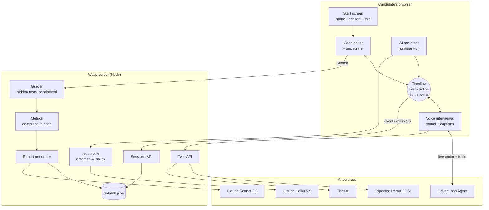

# Overwatch

**The first-round interviewer you'd hire for the AI era.**

**Live demo: https://ychacks-production.up.railway.app**

Engineers code with AI every day, but most interviews still pretend AI doesn't exist. Overwatch runs a company's first-round coding assessment *with* AI allowed, and measures what actually matters now: how well a candidate builds with it.

A candidate solves a coding problem in the browser with an AI assistant. A **voice interviewer** (ElevenLabs) watches what they do and asks pointed questions about their real code and AI usage. At the end, the company gets an **evidence-backed report** and the full interview log.

> Built in about 2h45m at the **YC Startups × ElevenLabs Hackathon** (Waterloo, 22 Nov 2026) by 4 people driving parallel coding agents in **Codevisor**.

<!-- Add a screenshot or GIF here: workspace + interviewer caption + report -->

---

## What it does

- **Code with AI, under the company's rules.** A chat assistant (assistant-ui + Claude Haiku 5.5) knows the problem and the candidate's current code. The company picks the policy, enforced on the server:
  - **Full access:** writes anything.
  - **No full solutions:** explains and reviews, with snippets of 8 lines or less.
  - **Hints only:** guiding questions and code of 2 lines or less.
- **A voice interviewer on the call.** It greets the candidate, answers clarifying questions from the problem statement only, and asks one question at a time about the candidate's *actual* code:
  - About 15 s after AI code is inserted: an edge-case question if it's untested, "explain this part" if it's tested.
  - After 2 failing test runs in a row: "What do you think is going wrong?"
  - After about 4 meaningful lines of their own code: a question about those lines, by line number.
  - A 5-minute warning, then a polite close on submit.
  - At most about one question every 75 s, never while the candidate is talking, and it never nags during silence.
- **Hidden tests.** 4 visible tests run in the browser (Web Worker, 2 s timeout). 6 hidden tests run only on the server in a sandbox. Candidates see counts, never hidden inputs.
- **Evidence-backed report.**
  - **Metrics computed in code:** visible and hidden pass rates, time to first green run, prompt count and length, **AI code share** (share of final lines that came from the AI), **tested-after-insert rate**, interviewer questions, and candidate turns.
  - **Rubric scores from Claude Sonnet 5.5** (1–5 each): problem solving, AI usage, code quality, communication. Every strength or concern must cite a timestamp and a quote.
  - **Overall score and recommendation computed in code:** the average of the 4 scores. Strong yes ≥ 4.3, yes ≥ 3.5, lean no ≥ 2.7, otherwise no. Practice sessions show *Interview-ready / Almost there / Keep practising* instead.
- **Interview log.** The raw voice interview: every question with its timestamp, *why* it was asked, the candidate's replies, and the interviewer's private notes. Never summarised by AI. Downloadable as `.txt` or `.json`.
- **Twin: predict-then-probe (optional).** A "twin" of the candidate (Expected Parrot EDSL, with an optional LinkedIn profile via Fiber AI) predicts their answers to 4 warm-up questions. When the real answer surprises it, the interviewer asks one curious follow-up. Twin predictions **never** affect scores.
- **Company side.** Create an assessment (problem, AI policy, duration, voice on or off), share a link, and see candidates ranked by overall score with links to each report and interview log.

## How it works

Everything the candidate does becomes an event on one **timeline**. The voice interviewer reacts to those events live, and the report is built from the same events afterwards. Nothing is canned.



**Life of one interview:** choose a practice problem or open a company link → enter a name, consent and allow the mic → the interviewer greets you by name → code, run tests, ask the AI, insert its code → the interviewer asks about what you just did → submit (or time runs out) → hidden tests run on the server → the report generates in about 10–30 s.

## Quick start

**Requirements:** Node.js ≥ 24.22.1, Wasp 0.26 (`npm i -g @wasp.sh/wasp-cli@latest`), an Anthropic API key, an ElevenLabs agent. Optional: Python for the twin service, `cloudflared` for a public link.

```bash
git clone https://github.com/shaurmittal/ychacks.git && cd ychacks

# Keys (see the *.example files for exact variable names)
#   .env.server  → Anthropic API key
#   .env.client  → ElevenLabs agent ID
#   .env         → ElevenLabs, Expected Parrot, Fiber AI keys

wasp start
```

- **Deploy:** `railway up --ci` (builds the root `Dockerfile`; set `ANTHROPIC_API_KEY` and `REACT_APP_ELEVENLABS_AGENT_ID`, mount a volume at `/app/data`)
- **Public HTTPS link from a laptop** (needed for other people's microphones): `scripts/tunnel.sh <clientPort> <serverPort>`
- **Push the interviewer prompt to ElevenLabs:** `node scripts/sync-voice-agent.mjs` (the prompt lives in `docs/VOICE_INTERVIEWER.md`)
- **Twin service (optional):** `cd twin-py && .venv/bin/python -m twin serve --port <port>`. Without it, interviews skip the warm-up questions.

## Try it

| Show this | Do this |
| --- | --- |
| The catch | Practice OA → ask the AI for a full solution → **Insert** → don't run tests → about 15 s later the interviewer asks about a specific line or edge case |
| It reads your code | Type 5–6 lines of your own and pause → it asks about those lines by number |
| AI policy | `/company` → create an assessment with **Hints only** → ask for code → it refuses and asks guiding questions |
| Hidden tests | Submit code that passes the visible tests but misses an edge case → hidden failures appear as counts only |
| The report | After submitting: scores, AI code share, tested-after-insert rate, clickable timestamped evidence |
| Founder review | Report → **Interview log** → each question, why it was asked, and the answer → **Download log** |
| Ranking | `/company/practice-merge-bookings` → today's candidates ranked by score |

## Project structure

```
main.wasp.ts                 routes + API endpoints
src/shared/                  types, problems (hidden tests server-only), AI-share, interview log
src/client/pages/            Landing, Take, Report, Company, ranked list
src/client/workspace/        editor, test runner (+ Web Worker), start screen, timer, paste detection
src/client/assistant/        assistant-ui panel + adapter
src/client/voice/            ElevenLabs widget, trigger engine, twin client
src/client/timeline/bus.ts   the event bus
src/client/report/           report UI + interview log
src/server/                  store, sessions, assessments, grader, metrics, report, assist, twin proxy
twin-py/                     Expected Parrot twin + HTTP service (Python)
docs/                        spec, architecture, voice prompt, report rubric, demo script
scripts/                     tunnel.sh, sync-voice-agent.mjs
```

## Built with

| Piece | Technology |
| --- | --- |
| App framework | **Wasp 0.26** (React + Node, one `main.wasp.ts` spec) |
| Voice interviewer | **ElevenLabs Agents** (`@elevenlabs/react`), Claude Haiku 5.5 as the agent's LLM |
| AI assistant UI | **assistant-ui** (`@assistant-ui/react`) with a custom adapter |
| Assistant model | **Claude Haiku 5.5** |
| Report model | **Claude Sonnet 5.5** |
| Twin | **Expected Parrot EDSL** |
| Profiles | **Fiber AI** |
| Editor | Monaco |
| Storage | In-memory store saved to `data/db.json` |
| Hosting | **Railway** (one service: Wasp server also serves the client; `Dockerfile`) |
| How we built it | **Codevisor** |

## How we built it with Codevisor

Four people, one product, about 2h45m. Each of us drove coding agents in **Codevisor**, every lane in its own git worktree, running side by side:

| Lane | What it built |
| --- | --- |
| Workspace | Editor, test runner, timeline, problems |
| Assistant | assistant-ui panel, AI policies, AI-code-share detection |
| Voice | ElevenLabs interviewer, trigger engine |
| Report + company | Store, grader, metrics, report, company pages |
| Twin | Expected Parrot twin + Fiber AI profiles |

Shared rules lived in `AGENTS.md`, with fixed contracts and file ownership per lane, so parallel agents rarely collided. <!-- Add: number of commits per lane, screenshots of worktrees / machines / usage panels / iPhone app -->

### Bot bake-off: which AI coworker would we hire?
We gave three Codevisor agents different personas and had them take the same Overwatch interview through our API. Overwatch then ranked them:

| Rank | Candidate | Agent | Persona | Overall | Report highlight |
| --- | --- | --- | --- | --- | --- |
| <!-- fill --> | Careful Cara | Claude Code | Plans first, precise prompts, tests after every insert | | |
| <!-- fill --> | Stubborn Stan | Pi | Ignores the AI, writes everything himself | | |
| <!-- fill --> | Speedrun Sam | Codex | Pastes the AI's full solution and submits without testing | | |

## Fairness and privacy

- Fixed rubric, and every claim in a report needs timestamped evidence.
- Metrics and the overall score are computed in code, not by the AI.
- The twin only chooses follow-up questions; it never touches scores.
- A human makes the hiring decision.
- The interviewer listens and transcribes while the call is connected and unmuted, and candidates can mute at any time. It only *speaks* when spoken to, when a real event happens, or for the time warning and the close.

## What's next

- Run interviews inside real coding-agent environments, and score how candidates direct agents rather than a chat panel.
- More languages, custom rubrics, and ATS integrations.
- Optional video avatar for the interviewer.
- Feed real answers back into the twin.

## Team

<!-- Names, roles, links -->
