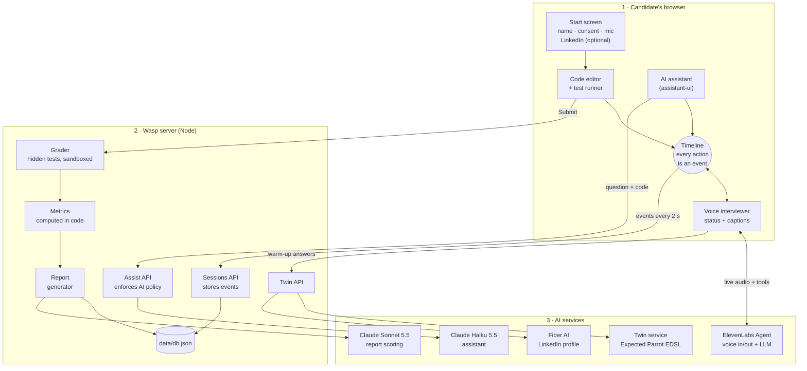

# Overwatch: what we built and how it fits together

**Overwatch is the first-round interviewer you'd hire for the AI era.** A candidate solves a coding problem in the browser with an AI assistant allowed. A voice interviewer (ElevenLabs) watches what they do and asks pointed questions about their real code and AI usage. At the end, the company gets an evidence-backed report and a full interview log.

Built at the YC Startups × ElevenLabs Hackathon (Waterloo, 22 Nov 2026) by 4 people driving parallel coding agents in Codevisor.

---

## 1. The whole system on one page



**The one idea to remember:** everything the candidate does becomes an event on a single **timeline**. The voice interviewer reacts to those events live, and the report is built from the same events afterwards. Nothing is canned or hardcoded.

---

## 2. The life of one interview

| # | What the candidate sees | What happens behind it | Where in the code |
| --- | --- | --- | --- |
| 1 | Picks a practice problem on the landing page, or opens a company's link | Fetches the assessment and the problem; hidden tests are stripped before anything reaches the browser | `LandingPage.tsx`, `GET /api/assessments/:id` → `server/assessments.ts` |
| 2 | Enters a name, ticks consent, allows the mic, optionally pastes a LinkedIn URL | Creates a session; the timeline starts (`session_start`) | `StartScreen.tsx`, `POST /api/sessions` → `server/sessions.ts`, `timeline/bus.ts` |
| 3 | The interviewer connects and greets them by name | The browser opens a voice call to the ElevenLabs agent with the candidate name, problem, AI policy and duration as variables | `voice/InterviewerWidget.tsx` |
| 4 | Writes code, presses **Run tests** | Visible tests run in a Web Worker with a 2 s timeout; code snapshots and results are logged | `workspace/Workspace.tsx`, `runner.ts`, `runner.worker.ts` |
| 5 | Asks the AI assistant for help, clicks **Insert into editor** | The server builds a prompt with the problem, their current code and the company's AI policy, then calls Claude Haiku; prompts, replies and inserts are logged | `assistant/AssistantPanel.tsx` → `POST /api/assist` → `server/assist.ts` |
| 6 | About 15 s after inserting AI code, the interviewer asks something like "What happens on line 10 when two bookings touch?" | The trigger engine sees the `insert` event with no test run since, and tells the agent to ask about that exact code, with line numbers | `voice/triggers.ts` |
| 7 | Answers out loud | ElevenLabs transcribes it; both sides of the conversation are logged; the agent can silently record a positive or concern note for the report | `InterviewerWidget.tsx` (client tools) |
| 8 | Early on, a few warm-up questions ("How are you planning to use the AI?") | The twin predicted their answers from a profile; a surprising answer gets one follow-up question | `server/twin.ts`, `twin-py/` |
| 9 | Clicks **Submit**, or the timer runs out | The server re-runs visible and hidden tests in a sandbox; the interviewer thanks them and the call ends | `POST /api/sessions/:id/submit` → `server/grader.ts` |
| 10 | Lands on the report and watches it generate (about 10–30 s) | Metrics are computed from the timeline, Claude Sonnet scores against a fixed rubric, and the overall score and recommendation are computed in code | `server/metrics.ts`, `server/report.ts`, `ReportPage.tsx` |
| 11 | (Company) opens the ranked list, reads the report and interview log | Candidates sorted by overall score; each row links to its report and interview log | `CompanyPage.tsx`, `AssessmentSessionsPage.tsx`, `report/InterviewLog.tsx` |

---

## 3. Feature by feature

### Candidate workspace
- **What:** problem statement, a dark Monaco editor, Run tests / Submit, and a countdown (red under 5 minutes, auto-submits at zero). Refreshing mid-session offers Resume.
- **Tests:** 4 visible tests run in the browser; 6 hidden tests run only on the server. The candidate sees counts like "hidden test 3 failed", never the hidden inputs.
- **Problems:** *Meeting room bookings* (`mergeBookings`) and *Knight's corner walk*. Both were picked so that AI gets a first draft right fast, but the edge cases separate people who verify from people who paste.
- **Files:** `src/client/pages/TakePage.tsx`, `src/client/workspace/*`, `src/shared/problems.ts`, `src/shared/evaluate.ts`.

### AI assistant (assistant-ui + Claude Haiku 5.5)
- **What:** a chat panel that knows the problem and the candidate's current code. Code in replies gets **Insert into editor** and **Copy**.
- **AI policy, set by the company, enforced on the server:**
  - **Full access:** writes anything.
  - **No full solutions:** explains, reviews and gives snippets of 8 lines or less, never the whole function.
  - **Hints only:** guiding questions and code of 2 lines or less.
  - The server reads the policy from the stored assessment, so a candidate can't change it.
- **Paste detection:** a manual paste counts as AI code if at least 60% of its lines match code the AI wrote earlier.
- **Files:** `src/client/assistant/*`, `src/server/assist.ts`, `src/server/assistPrompt.ts`, `src/shared/aiShare.ts`.

### Voice interviewer (ElevenLabs Agents)
- **What:** a live voice call in the right column, with a status (connecting, listening, speaking or muted), a mute button and a live caption of the interviewer's last line.
- **What it does:**
  - Greets the candidate and explains the format.
  - Answers clarifying questions from the problem statement only.
  - Asks one question at a time about the candidate's actual code.
  - Gives a 5-minute warning and closes politely.
- **When it speaks** (at most about one question every 75 s, never while the candidate is talking):

  | Trigger | When |
  | --- | --- |
  | AI code inserted | 15 s after an insert or AI paste: an edge-case question if untested, "explain this part" if tested |
  | Repeated failures | 2 failing test runs in a row: "what do you think is going wrong in this case?" |
  | New code | They wrote about 4 meaningful lines of their own: one question about those lines, by line number |
  | 5 minutes left | One-sentence warning |
  | Submit or time up | Thanks them and ends the call |

- **Never nags:** silence while coding is normal. It never asks "are you still there?" (the turn timeout is disabled on the agent, and there's no silence trigger).
- **Tools it can call in the browser:** `get_current_code`, `get_recent_events`, `flag_observation` (a silent note for the report), and `check_answer` (twin).
- **Prompt:** lives in `docs/VOICE_INTERVIEWER.md`; `scripts/sync-voice-agent.mjs` pushes it to the live agent.
- **Files:** `src/client/voice/InterviewerWidget.tsx` (call, tools, captions), `triggers.ts` (when to speak), `format.ts`.

### Twin: predict-then-probe (Expected Parrot + Fiber AI), Daniel's lane 05
- **What:** a "twin" of the candidate predicts how they'll answer 4 warm-up questions (approach, AI plan, confidence 1–5, worried-about edge case). When the real answer surprises the twin, the interviewer asks one curious follow-up.
- **Profile:** a baseline entry-level profile, or, if the candidate pastes a LinkedIn URL, role, seniority, skills and similar fields from **Fiber AI**. No personal identifiers are used.
- **Fairness:** predictions and surprise scores only decide follow-up questions. They are never written to the timeline, the metrics or the report.
- **Safe to switch off:** if the Python service isn't running, the interview carries on without warm-up questions.
- **Not wired yet:** the twin package can learn from real answers (`apply_correction`), but the app doesn't feed answers back into it yet.
- **Files:** `twin-py/` (Python service: `/predict`, `/score`, `/profile`, `/health`), `src/server/twin.ts` (`/api/twin/brief`, `/api/twin/check`, `/api/twin/:sessionId`), `src/client/voice/twin.ts`.

### Timeline (the backbone)
- **Event kinds:**
  - `session_start`, `session_end`
  - `code` (snapshots), `prompt`, `ai_reply`, `insert`, `paste` (with `fromAi`)
  - `test_run`, `submit`
  - `interviewer_said`, `candidate_said`
  - `interviewer_trigger` (why a question was asked), `flag` (interviewer notes)
- **How it's sent:** batched to the server every 2 s, and again when the page closes. The browser side also pushes events live to the voice interviewer.
- **Files:** `src/client/timeline/bus.ts`, `src/server/sessions.ts`, `src/server/store.ts`.

### Report (metrics in code + Claude Sonnet 5.5)
1. **Metrics, computed in code** (`src/server/metrics.ts`):
   - visible and hidden pass rates
   - time to first all-green test run
   - prompt count and average prompt length
   - **AI code share** (share of final lines that came from the AI)
   - **tested-after-insert rate** (share of inserts followed by a test run within 2 minutes)
   - interviewer questions, candidate turns, notes by severity
2. **Rubric scores from Claude Sonnet** (1–5 each):
   - **problem solving**
   - **AI usage:** precise prompts, verifies AI code, can explain it, catches AI mistakes
   - **code quality**
   - **communication**

   It sees the problem, policy, metrics, final code and the timestamped timeline. Every strength or concern must cite a timestamp and a quote.
3. **Overall score and recommendation, computed in code:** overall = the average of the 4 scores. Strong yes ≥ 4.3, yes ≥ 3.5, lean no ≥ 2.7, otherwise no. Practice sessions show "Interview-ready / Almost there / Keep practising" instead.
- **Page:** score bars, summary, strengths, concerns, AI-usage tiles, clickable evidence, final code, and the timeline.
- **Files:** `src/server/report.ts`, `src/client/pages/ReportPage.tsx`, `src/client/report/*`.

### Interview log (for founders' manual review)
- **What:** the raw record of the voice interview:
  - every interviewer turn, with its timestamp
  - the reason it was asked (e.g. "AI code inserted (lines 1–16), not tested")
  - the candidate's spoken replies
  - the interviewer's private notes
- **Raw:** never summarised or edited by the AI.
- **Downloads:** **Download log** as `.txt` or `.json`. Every candidate in the ranked list links straight to it.
- **Files:** `src/shared/interviewLog.ts`, `src/client/report/InterviewLog.tsx`.

### Company side
- **`/company`:** create an assessment (problem, AI policy, duration, voice on or off) and copy the candidate link.
- **`/company/:assessmentId`:** candidates ranked by overall score, with Report · Interview log links.
- **Practice:** the two practice assessments are seeded automatically; no sign-up needed.

---

## 4. Tech and partner tools

| Piece | Technology | Why |
| --- | --- | --- |
| App framework | **Wasp 0.26** (React + Node, `main.wasp.ts`) | Full-stack in one spec; routes and APIs declared in one file |
| Voice interviewer | **ElevenLabs Agents** (`@elevenlabs/react`), Claude Haiku 5.5 as the agent's LLM, Flash v2 voice | Low-latency voice, client tools, live contextual updates |
| AI assistant UI | **assistant-ui** (`@assistant-ui/react`) with a custom adapter | A production chat UI in minutes |
| Assistant model | **Claude Haiku 5.5** | Fast replies (2–4 s) |
| Report model | **Claude Sonnet 5.5** | Quality judgement with structured JSON output |
| Twin | **Expected Parrot EDSL** (Python) | Predicts answers; surprise drives follow-ups |
| Profiles | **Fiber AI** | Professional profile from a LinkedIn URL |
| Editor | Monaco | The VS Code editor in the browser |
| Storage | In-memory store saved to `data/db.json` | No database needed for a hackathon |
| Public link | Cloudflare tunnel (`scripts/tunnel.sh`) | HTTPS so strangers' mics work |
| Build process | **Codevisor**: 4 people, parallel agents, one git worktree per lane | Built in about 2h45m |

---

## 5. How to demo each part live

| Show this | Do this |
| --- | --- |
| The catch (the money shot) | Practice OA → ask the AI for a full solution → **Insert** → *don't* run tests → wait about 15 s → the interviewer asks about a specific line or edge case |
| It reads your code | Type 5–6 lines of your own and pause → it asks about those lines by number |
| AI policy | `/company` → create an assessment with **Hints only** → ask the AI for code → it refuses and asks guiding questions |
| Hidden tests | Submit a solution that passes visible tests but misses an edge case → hidden failures show as counts only |
| Evidence-backed report | After submit → the report: scores, AI code share, tested-after-insert rate, clickable timestamped evidence |
| Founder review | Report → **Interview log** → each question, why it was asked, and the answer → **Download log** |
| Ranking | `/company/practice-merge-bookings` → today's candidates ranked by score |

---

## 6. Honest answers for Q&A

- **Is anything faked?** No. Questions are generated from the live code and events; metrics are computed from the timeline; the report must cite timestamped evidence. The overall score is plain arithmetic on the 4 rubric scores.
- **Cheating?** Using AI is the point; we measure *how* it's used. Hidden tests run on the server, and the AI policy is enforced server-side. Proctoring is future work.
- **Bias or fairness?**
  - The rubric is fixed, and every claim needs evidence.
  - The metrics are computed in code, not by the AI.
  - The twin never affects scores.
  - A human makes the hiring decision.
- **Is it always listening?** While the call is connected and unmuted, yes: it hears and transcribes everything, so the report can credit thinking out loud. It only *speaks* when spoken to, when a real event happens, or for the time warning and the close. Candidates can mute at any time.
- **What we cut:** an interviewer face or video avatar (HeyGen LiveAvatar would replace our ElevenLabs client wiring), other languages, ATS integrations, custom rubrics, and feeding twin answers back as training data.

---

## 7. Where everything lives

```
main.wasp.ts                 routes + API endpoints (the map of the app)
src/shared/                  types, problems (with hidden tests; server only), AI-share, interview log
src/client/pages/            Landing, Take, Report, Company, ranked list
src/client/workspace/        editor, runner (+ Web Worker), start screen, timer, paste detection
src/client/assistant/        assistant-ui panel + adapter
src/client/voice/            ElevenLabs widget, trigger engine, twin client
src/client/timeline/bus.ts   the event bus
src/client/report/           report UI + interview log
src/server/                  store, sessions, assessments, grader, metrics, report, assist, twin proxy
twin-py/                     Expected Parrot twin + HTTP service (Python)
docs/                        spec, architecture, voice prompt, report rubric, demo script, this file
scripts/                     tunnel.sh (public link), sync-voice-agent.mjs (push prompt to ElevenLabs)
```

**Run it:** `wasp start` (or `scripts/tunnel.sh <clientPort> <serverPort>` for a public HTTPS link). Keys go in `.env.server` (Anthropic), `.env.client` (ElevenLabs agent ID) and `.env` (ElevenLabs, Expected Parrot, Fiber). The twin is optional: `cd twin-py && .venv/bin/python -m twin serve --port 8765`.
